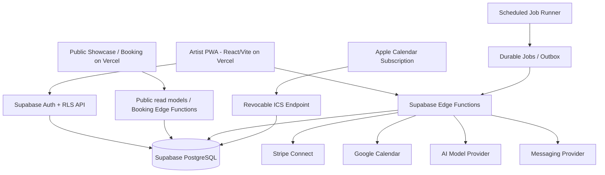

# MOVA
## Comprehensive Product Requirements, Technical Architecture & Codex Engineering Handoff
**Version:** 1.1 (V1 bilingual + acquisition reconciliation) | **Status:** Implementation baseline — product-owner approval required at release gate | **Date:** 2026-11-03

> **Mission:** Build a production-quality, mobile-first Progressive Web App for independent hairstylists to own their professional presence, operate across salons, manage bookings and clients, get paid, and grow through consent-based AI intelligence. **Brand:** `mova.` — *Your business moves with you.*
>
> **Instruction to Codex engineers:** Implement the contracts and acceptance tests in this specification. Do not treat examples as verified provider capabilities. Where a decision is flagged **APPROVAL REQUIRED**, implement behind a disabled feature flag or stop for product-owner approval. Do not declare production-ready or deploy production without the final signoff checklist.

---

# 0. Document control and decision register

## 0.1 Locked decisions

| ID | Decision |
|---|---|
| D-01 | Primary ICP: independent **hairstylists** working as booth/chair renters, multi-location professionals, or in commission arrangements; secondary ICP: analogous independent beauty professionals. |
| D-02 | One **mobile-first web app/PWA**, not React Native/Expo; React + TypeScript + Vite on Vercel. |
| D-03 | Supabase for PostgreSQL, Auth, Storage, Edge Functions, and scheduled/background functions. |
| D-04 | Artist experience: Home, Calendar, Clients, Growth, Business bottom tabs; public customer showcase and booking without requiring a customer account. |
| D-05 | Seven MVP pillars: showcase; multi-location calendar; booking/payment orchestration; Google presence; AI Revenue Agent; predictive rebooking; stylist wallet card. |
| D-06 | Booking modes: **instant** only where Mova controls inventory; **request** where external salon verification is needed. |
| D-07 | MVP payment types: Stripe, eligible Apple Pay/Google Pay/Cash App Pay via Stripe; manually recorded Zelle and cash; salon-collected payments. |
| D-08 | Proposed plans: Free $0 + 1.5% platform fee; Pro $19 + 1.0%; AI Growth $39 + 0.5%; fees only on eligible Mova-processed transactions; processing costs additional. Final entitlements require approval. |
| D-09 | Google Calendar outbound event sync and Apple Calendar private subscribed iCalendar feed are MVP. Outlook and true two-way calendar blocking are deferred. |
| D-10 | Locked visual identity: forest `#18392F`, botanical `#264E3E`, sage `#8BA990`, mint `#C9E6D4`, ivory `#F7F5EF`, peach `#E7C3AA`; Manrope + DM Sans; editorial beauty-first UX. |
| D-11 | No production launch until product owner signs off. |
| D-12 | V1 US bilingual: default `en-US`, supported `es-US`; independent artist and guest locale. |
| D-13 | V1 bilingual acquisition surfaces: crawlable SEO/AEO marketing, calculator, consented waitlist, attribution; $200 paid campaign is a proposed experiment, not live spend. |
| D-14 | Logo image is a concept; final vector/logo and trademark clearance require approval. |

## 0.2 Approval-required decisions / defaults

| ID | Question | Safe engineering default until approved |
|---|---|---|
| A-01 | Exact plan entitlements and usage limits | Entitlement table and feature flags; no paid restrictions hardcoded; use configurable plan matrix. |
| A-02 | Stripe Connect account type, charge topology, refunds, negative balances, disputes, merchant of record, tax | Build abstraction; do not enable live processing until compliance and Stripe design review. |
| A-03 | SMS/email provider and sending limits | Provider adapter with sandbox transport; AI outbound disabled by default. |
| A-04 | AI model/vendor, prompt evaluation thresholds, spend caps | Provider-agnostic interface, deterministic baseline, model feature flag off until evaluated. |
| A-05 | Google Business Profile eligibility and permitted API operations | Manual link and guidance works; API sync behind capability checks and approval. |
| A-06 | Apple/Google Wallet pass issuer, certificates, refresh mechanisms | Downloadable share card and booking QR as fallback; native wallet passes feature-flagged. |
| A-07 | Brand/domain/trademark clearance and final artist URL shape | Use configurable domain and `/artists/:handle`; do not assume domain ownership. |
| A-08 | Client consent policy, retention schedule, salon data ownership, marketing compliance | Minimal data collection; consent-first; legal review required before messaging or data import beyond owned data. |
| A-09 | Final notification channels and PWA push coverage | In-app and email sandbox first; graceful unsupported-browser states. |
| A-10 | Calendar event details visible to external providers | Default to privacy-minimized title and no client phone/email; artist can opt in to more detail. |
| A-11 | Financial earnings estimates and commission calculations | Clearly label estimates; no payroll/tax/settlement representation. |

| A-12 | Spanish legal/financial/consent translations and editorial QA | Block release of critical untranslated flows until human-reviewed. |
| A-13 | Public marketing and artist URL routing, `hreflang` and SSR/prerender strategy | Write ADR; default to canonical artist URL and `/en/`, `/es/` marketing routes. |
| A-14 | Production waitlist privacy, email consent, anti-bot and domain | No fake success or production submission until verified backend and privacy review. |
| A-15 | Final logo vector usage and trademark | Treat generated logo as concept, not final brand asset. |

**No agent may resolve A-01–A-15 by inventing business rules.** Record decisions in `docs/decisions/ADR-*.md` and request approval for material changes.

# 1. Product Requirements Document

## 1.1 Problem, positioning, and target user

Independent hairstylists often build their clientele across rented chairs, commission salons, and multiple locations. Their booking tools, client histories, payments, portfolios, and operating policies are fragmented or controlled by the location. Mova supplies a **portable professional identity and business operating layer**, while respecting the salon's ownership of its own systems and records.

**Primary user:** independent hairstylist who controls some combination of branding, services, clients, availability, and compensation. **Secondary users:** nail/lash/skin/barber and other independent beauty providers with analogous rental or commission structures. **Customer:** end client browsing the artist's public showcase and booking an appointment. **Non-goal:** salon ERP, staff payroll, salon-wide POS replacement, a discovery marketplace, or universal integrations with proprietary salon scheduling systems.

**Master product/business source:** `MOVA_Master_Product_Business_Blueprint_v1.md` (business decisions, limitations, go-to-market). **North-star metric:** completed service appointments managed or attributed through Mova per activated artist per month. Supporting KPIs: showcase publish rate, booking activation rate, first booking time, request-to-confirmation rate, repeat booking rate, connected calendar rate, processed GMV, artist retention, outreach conversion, AI recommendation precision, support burden, and failed sync/job rate. All metrics must have event definitions and deduplication keys.

## 1.2 User roles and permissions

| Role | Scope | Rights |
|---|---|---|
| Artist owner | Own business/artist tenant | Manage profile, services, locations, clients they lawfully control, payments, integrations, AI settings. |
| Artist collaborator (future-ready) | Explicitly delegated tenant | Permission-scoped access; no default financial or export access. MVP may ship with only owner role. |
| Customer/guest | Public booking flow | View published public information; submit booking; manage their own appointment only through expiring, scoped token. |
| Platform support/admin | Explicit support workflows | Restricted, audited, time-limited elevated actions; no blanket unrestricted access through ordinary UI. |
| Service worker | Background execution | Least-privilege service credentials; scoped, audited functions. |

Tenant = `artist_business_id` (UUID), separate from Supabase Auth user ID. A person may eventually own multiple businesses; avoid coupling tenant ID to user ID. Artist ownership must be verifiable via membership table.

## 1.3 MVP features, workflows, and acceptance criteria

### F01. Identity, onboarding, publishing
**Flow:** Sign up/sign in → verify email → choose handle → add hair specialties and profile → services → optional work location and schedule → payment setup where needed → preview → publish showcase → activate booking per location when ready.

**Rules:** Showcase may publish before booking activation. Artist handles unique case-insensitively, reserved words excluded. Required profile fields minimal. Each location has independent `booking_mode`, `calendar_ownership`, `payment_collector`, hours, services, and policies. Onboarding progress persisted across sessions. Draft content private. Published content accessible anonymously only through explicit public view.

**AC:** Artist can publish a showcase without Stripe; no Book button if no bookable location/service; draft never appears in public index; reloading onboarding restores progress; handle collisions handled with clear UX; accessibility and 360px layout pass.

### F02. Public showcase, portfolio, Book This Look
**Flow:** Customer visits public artist URL → views artist bio/specialties/locations/portfolio → taps a look or service → sees corresponding eligible services → begins booking.

**Rules:** Portfolio photo belongs to tenant, includes alt text, display order, optional mapped service(s), and publish state. Images optimized with responsive sizes. Public pages have crawlable metadata, canonical URL, OpenGraph image, and index/noindex controls. Artist branding cannot override accessible text contrast.

**AC:** Published artist appears with correct services and portfolio; unpublished/private images cannot be fetched via public listing; Book This Look preselects mapped service; missing mappings prompt service selection; social previews render without client-side JS dependency.

### F03. Services, locations, availability
**Flow:** Artist creates service (duration, base price, optional buffer, deposit policy) → configures one or more locations → specifies per-location services, operating hours, exceptions, booking mode, timezone and payment collector → publishes availability.

**Rules:** All times stored as UTC instants plus IANA timezone context. Local working hours are interpreted using the location timezone, including DST. A service may have location-specific price/duration overrides. Time slots must honor duration + buffers, closure dates, lead time, advance booking window, existing appointments, and pending holds. Availability is never inferred from a salon's external system unless supported by an authorized integration.

**AC:** Overlap rejection at database transaction boundary; DST boundary tests; two locations with distinct hours; unpublished services cannot be booked; cancellation/reschedule releases or reassigns inventory correctly.

### F04. Appointment booking lifecycle
**Customer flow:** Select service → location → available slot or request preference → customer details and consent → deposit where applicable → submit → receive `confirmed` (instant) or `pending_artist` (request) status → notifications.

**Artist flow:** View appointment/request → accept/reject/reschedule → record service completion/no-show/cancellation → reconcile payment and client history.

**State machine:** `draft` → `pending_payment` or `pending_artist` or `confirmed`; `pending_artist` → `confirmed|declined|expired`; `confirmed` → `completed|cancelled|no_show`; `pending_payment` → `confirmed|pending_artist|expired`. Reschedule is an audited transition updating start/end while preserving appointment identity; if new authorization/payment is needed, use explicit intermediate state. All state changes have actor, reason, timestamp, and idempotency key.

**AC:** Request mode never shows confirmed until artist action; duplicate submit cannot create duplicate booking; two simultaneous instant bookings cannot reserve same resource; customer sees accurate payment/confirmation status; expiration jobs safely release holds; notifications can retry without duplicate sends.

### F05. Client CRM, import, consent
**Flow:** Artist views clients → adds/edits client → records service preferences and visit history → imports CSV → previews mapping/deduplication → confirms import → sees provenance and consent status.

**Rules:** Tenant-scoped contacts, source attribution, opt-in by channel and purpose, timestamp and evidence, unsubscribe handling. Hair-specific optional fields include texture/length, color/formula notes, allergies/sensitivities only where genuinely needed and legally appropriate; avoid unnecessary sensitive fields. Never scrape or import salon-owned data without authorization. Fuzzy matches require review; do not auto-merge ambiguous contacts.

**AC:** Cross-tenant reads blocked; opt-out stops marketing; duplicate import idempotent; client deletion/export workflow supports applicable legal requests; customer records remain isolated from public showcase.

### F06. Payments, deposits, ledger
**Flow:** Artist connects eligible Stripe account → sets location payment collector and deposit policy → customer pays through supported Stripe method when applicable → webhook reconciles payment → appointment balance updated → refund/cancellation if needed. Cash/Zelle/salon-collected amounts recorded manually with provenance.

**Rules:** No trust in client-supplied prices/fees; amount in integer minor units, currency explicit; fee schedule effective-dated; processor fees and platform fees separate; never charge manually recorded payment; no double-charge deposit/balance; refunds represented as reversing ledger entries; salon-collected funds excluded from artist cash and Mova GMV; webhook signatures verified and idempotent; PII and card data never stored directly.

**AC:** Paid/deposit/balance calculations reconcile; retries do not duplicate charge or ledger entry; disconnected Stripe account blocks integrated checkout but not showcase; refund state reflects processor confirmation; dispute and failed payment paths visible; fee audit shows plan version and calculation inputs.

### F07. Google/Apple calendar outbound sync
**Flow:** Artist opens Business → Calendar Sync → connects Google via OAuth or copies private Apple iCalendar subscription URL → chooses locations and privacy level → new/updated/cancelled Mova appointments reflected in external calendar.

**Rules:** Google OAuth tokens encrypted at rest and refresh handled server-side; use minimum OAuth scopes; `external_calendar_events` mapping persists provider event IDs; idempotent create/update/delete; retry transient failures with backoff; expose sync health and manual retry. Apple subscribed `.ics` feed uses high-entropy revocable token; `UID` stable, `SEQUENCE` increments on changes, `DTSTAMP` and timezone valid, cancellations represented appropriately. Apple refresh cadence is controlled by Apple and cannot be promised as immediate. `Add to calendar` `.ics` download is fallback, not auto-sync. Never put raw subscription tokens in logs or analytics.

**AC:** New booking appears in connected Google calendar; reschedule updates same event; cancellation updates/removes event; revoked token denies old feed; subscription URL rotates; calendar privacy default hides customer contact data; timezone and DST tests; disconnected provider has nonblocking UI state. **No external-event-to-Mova availability blocking in MVP.**

### F08. AI Revenue Agent and predictive rebooking
**Flow:** Daily/scheduled rules evaluate service history and available slots → create scored opportunities with supporting evidence → artist reviews recommendation → approves or edits suggested outreach → delivery provider sends only to eligible consented recipients → attribution links resulting bookings.

**Rules:** Deterministic eligibility and consent before any model call; explainability fields (`reason_codes`, evidence, confidence, expected impact range); low-quality or missing history produces no confident prediction. No autonomous marketing sends in MVP without explicit artist approval. Provider-specific prompt/version logs exclude unnecessary PII. Rate limits, quiet hours, suppression, opt-out, cost budgets, retries, and human review. Model output validated against JSON schema; never execute model-generated SQL or arbitrary instructions.

**AC:** Opted-out client cannot be targeted; no outreach without approval; no fabricated certainty; each opportunity references source data; campaigns are auditable; duplicate sends blocked; control panel disables AI and sending immediately; evaluate against seeded known scenarios and baseline metrics.

### F09. Google Business Presence
**Flow:** Artist enters public Google Business Profile/booking link → sees eligibility guidance → if authorized integration available, connects supported account → syncs only permitted fields or links → monitors status.

**Rules:** No assumption that all booth renters qualify for a separate GBP or that Google API supports desired operations for every account. Unsupported operations display manual instructions; no fake “synced” success.

**AC:** Manual link works; integration capability is explicit; provider failures show recoverable status; no unauthorized changes to third-party listings.

### F10. Artist wallet card
**Flow:** Artist creates branded digital identity with artist name, profile URL, QR code → shares or saves; native Apple/Google Wallet pass creation enabled only after issuer/certificate and platform review.

**AC:** Shareable QR points to published profile; invalid/unpublished profile handled; no false claim of wallet installation; wallet passes behind feature flag until provider requirements validated.

### F11. PWA and notifications
**Flow:** Browser visits Mova → install prompt/help when eligible → installed standalone app opens artist Home → user receives eligible booking notices via supported push/email.

**Rules:** `manifest.webmanifest`, service worker, icon set, safe caching, offline shell, network-required transactional actions. Never cache authenticated financial/client API responses in a shared public cache. Browser support and iOS Home Screen web-push constraints explained. Background sync cannot be relied upon for financial correctness.

**AC:** Lighthouse/PWA checks; 360/390/430px viewports; safe-area insets; screen reader labels; keyboard flows; install and update lifecycle; offline booking action blocked with clear retry; push permission requested contextually.

### F12. Subscription and entitlements
**Flow:** Artist selects plan → Stripe subscription checkout → webhook updates entitlement record → app gates features server-side and shows plan status → upgrade/downgrade/cancel supported.

**Rules:** Proposed fee tiers in D-08; precise features and quotas require A-01 approval. Billing changes effective-dated; grace period and payment failure behavior configurable. Entitlements verified in backend, never only UI.

**AC:** Feature gating cannot be bypassed via direct API; Stripe webhook is idempotent; plan downgrade does not destroy customer data; billing reconciliation report available.

### F13. Internationalization and US Spanish — **release-critical V1**
**Requirements:** `en-US` default; `es-US` selectable before authentication and during guest booking. Artist locale and guest locale must be independent. Persist artist preference in `artist_profiles.preferred_locale` or equivalent and guest choice in scoped session/booking record; never force artist locale onto guests. All onboarding, navigation, validation, booking statuses, deposits/refunds, consent/policy text, transactional email/SMS, notifications, critical help, and AI outreach drafts must be localized. Artist-authored portfolio and service content stays original-language absent explicit opt-in translation. Server uses locale-aware templates and formats USD, dates and IANA time zones with `Intl`. Missing critical Spanish translations block release. English fallback is permissible only for documented noncritical copy; never silently fallback for policy/payment/consent.

**File contracts:** `apps/web/src/i18n/{index.ts,locale.ts,resources/en-US/{common,onboarding,booking,payments,clients,growth,legal,marketing}.json,resources/es-US/{...}.json}`, `apps/web/src/components/LanguageSwitcher.tsx`, `packages/contracts/src/locale.ts`, `supabase/functions/_shared/i18n/{index.ts,templates.ts}`, localized email/SMS templates, and `scripts/check-locales.mjs`. `react-i18next` is proposed default, subject to ADR. Keys must be stable, type-checked, parity-checked; no hardcoded user-facing strings. Extend analytics events with locale, without exposing personal data.

**Acceptance:** mobile 320/360px English/Spanish onboarding, showcase, request/instant booking, checkout, refund notices and notifications pass; switching language retains selections and booking status; guest language does not change artist dashboard; screen readers announce appropriate `lang`; critical Spanish translations are human-reviewed; locale key parity and missing critical string tests fail CI. Add F13 cases to QA CSV; existing 179-case inventory is **not exhaustive** until regenerated.

### F14. Organic acquisition, AEO/SEO, calculator and waitlist — **release-critical V1**
**Requirements:** Production marketing site and core calculator in both `en-US` and `es-US`; published, crawlable HTML, canonical/hreflang/OG metadata, valid sitemap/robots, approved domain, accessible performance-minded layouts, original useful content, artist-public indexing controls. No guarantee of AI assistant placement. Booth Rent vs Commission Calculator is free, works without signup, never transmits entered financial values to marketing/analytics, clearly labels estimates (not tax or legal advice). Initial editorial cluster: booth rent vs commission, keeping clients when changing salons, multi-location booking. Localized article priority and quality review documented.

**Waitlist:** Supabase-backed endpoint validates input, artist qualification and consent; records locale, timestamp, UTM/source, opt-in scope and deduplication; rate limits, bot defense, least privilege, export/delete path, honest pending/error/success states. Email capture cannot claim success before persistence. Event taxonomy: `landing_view`, `calculator_view`, `calculator_completed`, `waitlist_submit`, `waitlist_success`, `qualified_artist_signup`, `showcase_published`, `booking_enabled`, `first_booking_completed`; analytics consent and privacy apply. Public artist showcases are indexable only when published and explicitly allowed; draft/private noindex and no public fetch. Domain/SEO architecture approved in ADR before production.

**File contracts:** `apps/web/src/pages/marketing/{HomePage,CalculatorPage,GuidePage,WaitlistPage}.tsx`, `apps/web/src/features/acquisition/{BoothRentCalculator,WaitlistForm,utm,analytics}.ts(x)`, `apps/web/src/content/{en-US,es-US}/`, `apps/web/src/lib/seo/{metadata,hreflang,canonical}.ts`, `supabase/migrations/*_acquisition_waitlist.sql`, `supabase/functions/waitlist-signup/index.ts`, `packages/contracts/src/acquisition.ts`, `scripts/{render-public-pages,generate-sitemap,validate-seo}.mjs`, `tests/{e2e,unit,security}/acquisition*`. Final names must be represented in the file-level plan and traceability.

**Acceptance:** calculator sample $1,500 weekly revenue, 40% commission cut, $300 rent, $150 shared expense yields $750 commission vs $1,050 booth and $300 difference; reject negative/over-100% inputs; no user-entered financial data sent to third parties. Test waitlist success/invalid/duplicate/abuse/rate-limit/consent and source attribution; test English/Spanish SEO metadata, `hreflang`, canonical, robots and sitemap; JS-disabled crawlability; no fake domain or testimonials. $150 Meta + $50 reserve is a **proposed** test and cannot be treated as spent/approved by engineering.

# 2. Experience architecture and screen contracts

## 2.1 Navigation
- Authenticated `/app/home`, `/app/calendar`, `/app/clients`, `/app/growth`, `/app/business`.
- Public `/artists/:handle`, `/artists/:handle/book`, `/booking/:publicToken/status`.
- Auth `/login`, `/signup`, `/auth/callback`, onboarding `/onboarding/*`.
- Deep links support appointment details and campaign opportunities with authorization.

## 2.2 Screen inventory and additions
Initial 26-screen design baseline: 6 onboarding, 16 artist app, 4 customer screens. Add explicit subflows: calendar sync settings/status, client CSV import/dedupe, booking request review, cancellation/refund, integration health, subscription/plan management, notification preferences, data export/deletion, accessibility/offline/error states. Each screen must implement loading, empty, success, error, permission-denied, and mobile keyboard/safe-area behavior.

## 2.3 Design tokens
Use Manrope for display/headings and DM Sans for body, CSS variables for locked colors; 8px spacing system, 20px mobile gutter, touch targets >=44×44 CSS pixels, visible focus, reduced motion, contrast WCAG 2.2 AA where applicable. Public pages more editorial; business pages operational. Avoid generic stacked SaaS card overload. All generated sample content clearly marked illustrative; no fake live data.

# 3. Technical architecture

## 3.1 Deployment topology



**Web rendering:** Vite SPA for authenticated app; public showcase routes must have crawlable, server-generated/prerendered HTML, metadata and social previews. Choose a Vercel-compatible rendering adapter in ADR before implementation. Do not silently switch entire app framework. Use HTTPS and custom domains only after verified ownership.

## 3.2 Repository layout

```text
mova/
  apps/web/
    src/app/                # route shells, layouts, providers
    src/features/           # auth, onboarding, showcase, calendar, clients,
                            # booking, payments, growth, business, integrations
    src/components/         # Mova UI primitives and shared patterns
    src/styles/             # tokens, fonts, responsive styles
    src/lib/                # supabase client, query keys, API client
    public/                 # icons, manifest, static assets
    tests/                  # unit and component tests
  packages/domain/          # types, enums, Zod schemas, pure domain rules
  packages/design-tokens/   # tokens and shared theme values
  packages/api-contracts/   # typed request/response contracts
  supabase/migrations/      # versioned SQL, policies, constraints, indexes
  supabase/functions/       # Edge Functions and shared server utilities
  supabase/tests/           # RLS, pgTAP/SQL, transactional integration tests
  tests/e2e/                # Playwright device/flow tests
  tests/contracts/          # provider mocks and contract tests
  docs/architecture/        # diagrams, decisions, threat model
  docs/runbooks/            # deploy, restore, reconciliation, incident
  docs/decisions/           # ADRs and product approval decisions
  .github/workflows/        # CI
```

## 3.3 Client-server trust boundaries
1. Browser may read/write permitted tenant data through Supabase client **only with RLS**; do not expose service-role key in browser.
2. All booking transitions, availability reservation, pricing, deposits, refunds, fee assessment, messaging, and AI actions run through authenticated server functions or narrowly scoped guest endpoints.
3. SQL transactions and constraints are final source of truth for resource conflicts and money movements.
4. Third-party credentials and webhooks live only on server. Secrets from environment/secret manager; never checked in.
5. Public read model exposes only explicitly published fields; do not grant anonymous SELECT to base client/payment tables.

## 3.4 Background job pattern
Use transactional outbox and durable jobs table with `queued|running|succeeded|failed|dead`, attempt count, `next_run_at`, lease owner/expiry, idempotency key, last error. Supabase scheduled trigger invokes worker; worker claims jobs atomically (`FOR UPDATE SKIP LOCKED` or equivalent), retries with exponential backoff and jitter, dead-letter alerting. External side effects require provider idempotency keys. Never assume scheduled Edge Functions alone guarantee exactly-once execution.

# 4. PostgreSQL schema specification

## 4.1 Common conventions
- Primary IDs UUID with `gen_random_uuid()`; timestamps `timestamptz` UTC; business timezone IANA string.
- All tenant-owned tables have `artist_business_id uuid NOT NULL` and foreign key to `artist_businesses(id)`.
- Currency ISO-4217 text, amounts bigint minor units; no floating point for money.
- Soft-delete where needed; use event history and immutable financial ledger rather than mutating financial history.
- Uniqueness/indexes scoped to tenant; provider IDs unique by provider/account; PII encrypted where appropriate.
- `created_at`, `updated_at` on mutable entities, with server-managed update trigger.

## 4.2 Entity catalog (required columns)

| Table | Required columns / notable constraints |
|---|---|
| `artist_businesses` | `id`, `owner_user_id`, `display_name`, `handle citext UNIQUE`, `status`, `timezone`, `published_at` |
| `artist_memberships` | `id`, `artist_business_id`, `user_id`, `role`, `status`, UNIQUE(business,user) |
| `artist_profiles` | `artist_business_id PK/FK`, `bio`, `specialties jsonb`, `avatar_path`, `cover_path`, `contact_visibility`, `seo_settings jsonb` |
| `onboarding_progress` | `artist_business_id`, `step`, `completed_steps jsonb`, `updated_at` |
| `locations` | `id`, `artist_business_id`, `name`, `timezone`, `address_fields`, `booking_mode`, `calendar_ownership`, `payment_collector`, `status` |
| `location_hours` | `id`, `artist_business_id`, `location_id`, `weekday`, `start_local`, `end_local`, `effective_from`, `effective_to` |
| `location_exceptions` | `id`, `artist_business_id`, `location_id`, `date`, `is_closed`, `start_local`, `end_local`, `reason` |
| `location_policies` | `location_id`, `artist_business_id`, `lead_minutes`, `advance_days`, `cancellation_window_hours`, `deposit_policy jsonb`, `buffer_policy jsonb` |
| `compensation_agreements` | `id`, `artist_business_id`, `location_id`, `type`, `rate_basis_points`, `flat_amount_minor`, `effective_from`, `effective_to`, `notes` |
| `services` | `id`, `artist_business_id`, `name`, `category`, `description`, `duration_minutes`, `price_minor`, `currency`, `buffer_minutes`, `status` |
| `service_locations` | `artist_business_id`, `service_id`, `location_id`, `price_override_minor`, `duration_override_minutes`, `is_active`, UNIQUE(service,location) |
| `portfolio_items` | `id`, `artist_business_id`, `storage_path`, `alt_text`, `caption`, `sort_order`, `is_published` |
| `portfolio_service_links` | `artist_business_id`, `portfolio_item_id`, `service_id`, UNIQUE(item,service) |
| `clients` | `id`, `artist_business_id`, `name`, `email`, `phone_e164`, `preferences jsonb`, `source`, `deleted_at` |
| `client_consents` | `id`, `artist_business_id`, `client_id`, `channel`, `purpose`, `status`, `captured_at`, `source`, `proof_ref` |
| `client_import_batches` | `id`, `artist_business_id`, `file_path`, `status`, `mapping jsonb`, `stats jsonb`, `approved_at` |
| `availability_blocks` | `id`, `artist_business_id`, `location_id`, `starts_at`, `ends_at`, `reason`, `source` |
| `appointments` | `id`, `artist_business_id`, `location_id`, `service_id`, `client_id`, `starts_at`, `ends_at`, `status`, `booking_mode`, `currency`, `gross_minor`, `deposit_required_minor`, `source`, `version` |
| `appointment_events` | `id`, `artist_business_id`, `appointment_id`, `event_type`, `actor_type`, `actor_id`, `payload jsonb`, `created_at`, `idempotency_key` |
| `booking_holds` | `id`, `artist_business_id`, `location_id`, `starts_at`, `ends_at`, `expires_at`, `status`, `request_key` |
| `payment_accounts` | `id`, `artist_business_id`, `provider`, `external_account_id`, `status`, `capabilities jsonb` |
| `payments` | `id`, `artist_business_id`, `appointment_id`, `provider`, `method`, `collector`, `amount_minor`, `currency`, `status`, `external_payment_id`, `idempotency_key` |
| `refunds` | `id`, `artist_business_id`, `payment_id`, `amount_minor`, `status`, `external_refund_id`, `reason` |
| `financial_ledger` | `id`, `artist_business_id`, `appointment_id`, `payment_id`, `entry_type`, `account`, `amount_minor_signed`, `currency`, `source_event_id`, `created_at` |
| `plans` | `id`, `code`, `monthly_price_minor`, `platform_fee_bps`, `version`, `effective_from`, `effective_to` |
| `subscriptions` | `id`, `artist_business_id`, `plan_id`, `provider_subscription_id`, `status`, `period_start`, `period_end` |
| `entitlements` | `id`, `plan_id`, `feature_key`, `enabled`, `quota_value`, UNIQUE(plan,feature) |
| `integration_connections` | `id`, `artist_business_id`, `provider`, `status`, `scopes`, `encrypted_credentials_ref`, `last_synced_at`, `last_error_code` |
| `calendar_sync_settings` | `artist_business_id`, `provider`, `connection_id`, `selected_location_ids`, `privacy_level`, `enabled` |
| `external_calendar_events` | `id`, `artist_business_id`, `appointment_id`, `connection_id`, `provider_event_id`, `last_synced_version`, `status` |
| `calendar_feed_tokens` | `id`, `artist_business_id`, `token_hash`, `revoked_at`, `created_at`, `last_used_at` |
| `growth_opportunities` | `id`, `artist_business_id`, `type`, `client_id`, `appointment_id`, `reason_codes jsonb`, `evidence jsonb`, `score`, `status`, `model_version` |
| `rebooking_predictions` | `id`, `artist_business_id`, `client_id`, `service_id`, `predicted_from`, `predicted_to`, `confidence`, `evidence jsonb`, `version` |
| `outreach_campaigns` | `id`, `artist_business_id`, `opportunity_id`, `channel`, `draft`, `approved_by`, `approved_at`, `status` |
| `outreach_events` | `id`, `artist_business_id`, `campaign_id`, `client_id`, `provider_message_id`, `status`, `sent_at`, `idempotency_key` |
| `wallet_cards` | `id`, `artist_business_id`, `public_url`, `qr_asset_path`, `status`, `provider_ref` |
| `outbox_events` | `id`, `artist_business_id`, `aggregate_type`, `aggregate_id`, `event_type`, `payload jsonb`, `created_at`, `published_at` |
| `background_jobs` | `id`, `artist_business_id`, `type`, `payload jsonb`, `status`, `attempts`, `next_run_at`, `lease_until`, `idempotency_key` |
| `audit_events` | `id`, `artist_business_id`, `actor_type`, `actor_id`, `action`, `target_type`, `target_id`, `metadata jsonb`, `created_at` |
| `platform_events` | `id`, `artist_business_id`, `event_name`, `subject_id`, `occurred_at`, `properties jsonb`, `dedupe_key` |

**Implementation note:** This is the canonical logical schema; engineers must generate executable, ordered migrations, foreign keys, check constraints, indexes, RLS policies, and fixtures. Do not create a giant single migration with unreviewed circular dependencies. Sensitive fields should be stored with access-limited design, not blindly in public JSON blobs.

## 4.3 Critical SQL invariants (illustrative executable pattern)

```sql
create extension if not exists btree_gist;
-- If appointments represent one artist's exclusive time, prohibit overlap
-- among capacity-consuming confirmed/in-progress appointments.
alter table public.appointments
  add constraint appointments_valid_interval
  check (ends_at > starts_at);

alter table public.appointments
  add constraint appointments_no_confirmed_overlap
  exclude using gist (
    artist_business_id with =,
    tstzrange(starts_at, ends_at, '[)') with &&
  ) where (status in ('confirmed', 'completed'));
```

**Caution:** Final conflict interval must include service buffers, temporary holds, and resource/capacity semantics. The above constraint is a minimum illustration, not the complete booking algorithm. If historical completed appointments can overlap after manual correction, document an alternative resource reservation table with exclusion constraints. `pending_artist` requests should not consume confirmed inventory by default unless an explicit temporary hold policy is enabled.

```sql
-- Example tenant-membership helper; set secure search_path in production.
create or replace function public.is_artist_member(p_business_id uuid)
returns boolean language sql stable security definer
set search_path = public
as $$
  select exists (
    select 1 from public.artist_memberships m
    where m.artist_business_id = p_business_id
      and m.user_id = (select auth.uid())
      and m.status = 'active'
  );
$$;

alter table public.clients enable row level security;
create policy clients_member_select on public.clients
for select to authenticated
using (public.is_artist_member(artist_business_id));
```

**Security review required:** RLS policy helper must not permit untrusted membership writes; protect `artist_memberships` with strict owner-only policies, revoke unnecessary function grants, and test impersonation/cross-tenant attacks. Write policies must be separately defined (`WITH CHECK`) and role-scoped. Every tenant table needs explicit policies, not merely `ENABLE ROW LEVEL SECURITY`.

## 4.4 Required indexes
- `appointments(artist_business_id, starts_at)` and `(artist_business_id, status, starts_at)`.
- `clients(artist_business_id, lower(email))` partial where email present; similarly normalized phone; do not auto-merge on unique contact alone without policy.
- `services(artist_business_id, status)`; `locations(artist_business_id, status)`.
- `outbox_events(published_at, created_at)`; `background_jobs(status, next_run_at)`.
- `external_calendar_events(connection_id, appointment_id)` UNIQUE; provider event ID unique within connection.
- `payments(provider, external_payment_id)` UNIQUE where not null; `payments(artist_business_id, idempotency_key)` UNIQUE.
- `artist_businesses(lower(handle))` unique, reserved handle check.

# 5. API and function contracts

## 5.1 Conventions
All Edge Function endpoints versioned `/functions/v1/<name>` or a typed router with stable equivalent paths. Responses `{ data, error, request_id }`; errors `{ code, message, details? }`; never expose internal SQL/processor secrets. Authenticated requests use Supabase JWT; guest booking uses short-lived signed tokens, anti-abuse controls, and scoped capabilities. Mutations accept `Idempotency-Key` header. Validate all payloads with shared Zod schemas server-side. Version contract changes and publish OpenAPI JSON.

## 5.2 Endpoint matrix

| Function | Caller | Request | Success response | Required guarantees |
|---|---|---|---|---|
| `publish-showcase` | Artist | `{ businessId, publish }` | `{ status, publicUrl }` | Readiness check, tenant auth, audit. |
| `public-artist` | Guest | `{ handle }` | Public profile DTO | Only published fields, cache-safe. |
| `availability-search` | Guest/artist | `{ handle, serviceId, locationId, dateRange }` | `{ slots, timezone, bookingMode }` | Server-side calculation; no guarantee until reservation. |
| `booking-create` | Guest | `{ serviceId, locationId, startAt, client, consent, requestKey }` | `{ bookingToken, appointmentId, status, paymentRequirement }` | Rate limit, conflict transaction, idempotency. |
| `booking-status` | Guest with token | `{ bookingToken }` | Safe status DTO | Token-scoped; no private notes. |
| `booking-transition` | Artist | `{ appointmentId, action, expectedVersion, reason? }` | `{ appointment, version }` | State machine, concurrency check, audit. |
| `booking-reschedule` | Artist or authorized guest | `{ appointmentId, newStartAt, expectedVersion }` | `{ appointment, paymentAdjustment? }` | Atomic conflict check and notifications. |
| `stripe-connect-onboard` | Artist | `{ businessId, returnUrlKey }` | `{ redirectUrl }` | Verified redirect allowlist, ownership. |
| `payment-intent-create` | Guest/artist | `{ appointmentId, paymentPurpose }` | `{ clientSecret, amount, currency }` | Recalculate amount server-side; connected account capability. |
| `stripe-webhook` | Stripe | Raw signed body | 2xx ack | Signature verify, durable idempotent event ingest. |
| `refund-request` | Artist | `{ paymentId, amountMinor, reason }` | `{ refundId, status }` | Policy/permissions; no duplicate refunds. |
| `manual-payment-record` | Artist | `{ appointmentId, method, collector, amountMinor, note }` | `{ paymentId, ledgerStatus }` | Only cash/Zelle/salon; no processor claim. |
| `calendar-google-connect` | Artist | `{ businessId }` | `{ authorizationUrl }` | OAuth state/PKCE where supported, scoped credentials. |
| `calendar-google-callback` | Provider redirect | `{ code, state }` | Redirect/status | Validate state, bind correct artist. |
| `calendar-sync-settings` | Artist | `{ provider, enabled, locations, privacy }` | `{ status }` | Permission, outbox resync. |
| `calendar-sync-run` | Worker | `{ appointmentId, connectionId }` | `{ syncStatus }` | Idempotent provider mapping, retry. |
| `calendar-ics-feed` | Calendar subscriber | High-entropy token in URL | `text/calendar` | Token hash lookup, revocation, cache control, no secrets in logs. |
| `calendar-ics-rotate` | Artist | `{ businessId }` | `{ newSubscriptionUrl }` | Old token revoked immediately. |
| `client-import-preview` | Artist | `{ batchId, mapping }` | `{ preview, potentialDuplicates }` | No writes until approval. |
| `client-import-commit` | Artist | `{ batchId, resolutions }` | `{ imported, skipped, merged }` | Atomic batches or resumable idempotent chunks. |
| `growth-opportunities-list` | Artist | `{ filters }` | Opportunity DTOs | Explainability, scoped evidence. |
| `growth-opportunity-generate` | Worker/artist | `{ businessId, date }` | `{ jobId }` | Consent prefilter, bounded cost. |
| `outreach-approve` | Artist | `{ campaignId, content, recipientIds }` | `{ status }` | Consent rechecked at send time. |
| `outreach-send` | Worker | `{ campaignId }` | `{ sent, skipped }` | Quiet hours, opt-out, idempotent send. |
| `wallet-card-create` | Artist | `{ businessId }` | `{ qrUrl, shareUrl, walletStatus }` | Provider capability gating. |
| `subscription-checkout` | Artist | `{ planCode }` | `{ checkoutUrl }` | Plan from server config; safe return URLs. |
| `account-export` | Artist | `{ businessId }` | `{ jobId }` | Authorized export, expiring download. |
| `account-delete-request` | Artist | `{ businessId, confirmation }` | `{ requestId, state }` | Retention/legal hold workflow. |

## 5.3 Example booking request and response

```json
POST /functions/v1/booking-create
Idempotency-Key: 5e9f...unique-per-attempt
{
  "artistHandle": "sample-stylist",
  "serviceId": "uuid",
  "locationId": "uuid",
  "startAt": "2026-11-10T15:00:00Z",
  "client": { "name": "Sample Guest", "email": "guest@example.test" },
  "consent": { "transactional": true, "marketingEmail": false, "marketingSms": false },
  "requestKey": "uuid"
}

200 OK
{
  "data": {
    "appointmentId": "uuid",
    "status": "pending_artist",
    "bookingToken": "opaque-short-lived-token",
    "paymentRequirement": { "type": "none", "amountMinor": 0, "currency": "USD" }
  },
  "error": null,
  "request_id": "uuid"
}
```

**Contract caveat:** Public request token must not permit modification beyond its explicit scope; rate-limit token validation and do not return existing client data merely because email matches.

# 6. Security, privacy, compliance, and reliability

## 6.1 Threat model and controls

| Threat | Required control / test |
|---|---|
| Cross-tenant data leak | RLS on every private table; tenant-swap API and SQL integration tests; deny-by-default policies. |
| Guest booking enumeration | Opaque scoped tokens, generic error messages, rate limiting, no email-based data disclosure. |
| Double booking/race | PostgreSQL transaction, exclusion/lock strategy, concurrent load tests. |
| Price/fee tampering | Server recalculation from catalog/policy/plan version; mutation tests. |
| Forged webhook/replay | Signature validation, provider event uniqueness, transactional outbox. |
| OAuth account hijack | State verification, least scopes, secure token vault, revocation and reconnect. |
| Apple calendar feed leak | 256-bit random secret, hash stored, rotate/revoke, minimized PII, no logging, no public indexing. |
| Malicious image/upload | MIME/size checks, path isolation, image processing, safe content disposition. |
| AI prompt injection | Treat customer notes/imports as untrusted data; structured outputs, no arbitrary tool execution. |
| Unauthorized marketing | Consent by channel/purpose, suppression, approval, unsubscribe, audit and legal review. |
| Service-role key exposure | Secret scanning, server-only environment, CI policy, no browser bundling. |
| Data loss | Backups, restore rehearsal, migration rollback/forward strategy, recovery objectives. |

## 6.2 Security implementation checklist
- All traffic TLS; secure headers/CSP, restrictive CORS, cookie/session policy appropriate to auth flow.
- Input validation on every boundary, output encoding, parameterized SQL; no client-trusted `artist_business_id` authorization.
- RLS enforced with positive and negative tests for every table and view; security-definer functions narrowly scoped.
- Secrets stored only in deployment/Supabase secret management; key rotation and incident runbook.
- Audit logging for profile publishing, client export, financial changes, calendar connections, AI approvals, support access.
- Signed URLs for private media; public media only after explicit publish. Storage policies mirror DB tenant ownership.
- Minimal retention and documented deletion workflow; processor and messaging provider data-processing review.
- Financial reporting distinguishes estimates, external collections, actual processed money, fees, and refunds.
- Legal review before live payments, marketing messaging, client import from salon sources, or public GBP integration.

## 6.3 Reliability targets (proposed, approval required)
- Availability read p95 <= 1.0s excluding cold-start anomalies in staging load profile; booking commit p95 <= 2.5s excluding payment redirects; public page LCP <= 2.5s on representative mobile connection.
- Error rate for core booking create <= 0.5% excluding validation failures; no confirmed overlapping appointment in concurrency test suite.
- Job queue alerts on dead letters, oldest queued age, calendar sync failures, webhook backlog, payment reconciliation mismatch.
- Proposed recovery objectives: RPO <= 24h and RTO <= 8h initially, to be validated against purchased Supabase backup capabilities and business risk; no unsupported promise.
- Accessible core flows to WCAG 2.2 AA; support current mobile Safari and Chrome and representative desktop browsers.

# 7. Analytics and instrumentation

Define events in `packages/domain/analytics.ts` with schema and dedupe IDs:
`artist_signed_up`, `showcase_published`, `booking_enabled`, `portfolio_item_published`, `booking_started`, `booking_requested`, `booking_confirmed`, `booking_declined`, `booking_completed`, `booking_cancelled`, `payment_processed`, `payment_failed`, `calendar_connected`, `calendar_sync_failed`, `client_imported`, `growth_opportunity_created`, `outreach_approved`, `outreach_sent`, `outreach_converted`, `subscription_started`, `subscription_changed`, `subscription_cancelled`, `pwa_installed` (where detectable). Never put client names, emails, or full booking notes in analytics properties. Define funnel dashboards and reconciliation queries; ensure server-authoritative conversion events.

# 8. Executable engineering plan for Codex

## 8.1 Execution rules
1. Work in feature branches with one scoped PR per work package; no direct pushes to production branch.
2. Before coding each package: inspect existing repo, record differences from spec, produce implementation plan and affected files.
3. Each PR includes migrations, RLS, unit/integration/E2E tests, docs, screenshots for UI, and rollback notes when relevant.
4. No fabricated integrations, simulated payment success, placeholder AI outputs, or silent mock fallback in production. Mocks allowed only in tests/dev, visibly labeled.
5. All acceptance criteria must be traceable to tests; `not implemented` is not `passed`.
6. PRs with schema/financial/auth changes require human architecture review.
7. Keep external provider integrations behind adapters and feature flags until credentials and policy review.
8. At each milestone produce `docs/evidence/Mxx.md` with commit SHA, CI links, migrations, test results, screenshots, risks, and unresolved items.

## 8.2 Work packages and dependency graph

| WP | Deliverables | Depends on | Exit gate |
|---|---|---|---|
| WP00 | Repo bootstrap, pnpm workspace, Vite/React TS, lint/format/typecheck, CI, environment templates, Vercel preview, Supabase local | — | Clean build/CI, no leaked secrets. |
| WP01 | Mova design tokens, component library, mobile shell, five tabs, accessible primitives, PWA manifest/SW | WP00 | Visual review at 360/390/430px and keyboard/screen reader checks. |
| WP02 | Supabase core schema, memberships, RLS, auth, onboarding, profile publishing | WP00–01 | Tenant isolation suite; publish/draft E2E. |
| WP03 | Services, locations, schedules, exceptions, booking readiness and availability engine | WP02 | DST and concurrency test suite passes. |
| WP04 | Public showcase, portfolio, Book This Look, SEO/social metadata | WP02–03 | Public crawler HTML, guest booking entry, image security. |
| WP05 | Booking state machine, guest flow, holds, request review, notifications outbox | WP03–04 | Booking race, request vs instant, retry tests. |
| WP06 | Client CRM, consent, CSV import preview/dedupe, client history | WP02, WP05 | Cross-tenant and consent tests; import audit. |
| WP07 | Stripe Connect adapter, deposit/balance, manual payment, ledger, refunds | WP05–06, A-02 approval | Sandbox reconciliation and webhook replay tests. |
| WP08 | Google Calendar OAuth outbound sync, Apple ICS subscription, sync health | WP05 | New/update/cancel/revoke/DST provider contract tests. |
| WP09 | AI rule engine, rebooking prediction, opportunities, approvals, messaging adapters | WP05–06, A-03/04/08 | Offline evaluation and consent/approval tests. |
| WP10 | Google presence manual+capability-gated integration, share QR/wallet fallback | WP04, A-05/06 | Graceful unsupported-provider states. |
| WP11 | Plans, billing, entitlements, subscription events | WP07, A-01 approval | Direct API gating and billing reconciliation. |
| WP12 | Observability, analytics, accessibility, performance, security hardening, DR, UAT | All | Full release gate; product owner signs off. |

**Parallelism:** WP03 and WP04 may partially overlap after shared models; WP06 and WP08 can run after booking contracts stabilize; WP09 and WP10 can run independently once their dependencies and approvals are ready. Do not implement WP07 or WP11 live flows without payment/plan decisions.

## 8.3 Required per-package handoff template

```md
# WPxx Completion Report
- Scope / user stories / acceptance criteria IDs:
- Implementation branch / PR / commit SHA:
- Changed files and migrations:
- Architecture decisions and deviations:
- Unit test results (commands + counts):
- Integration/RLS/contract test results:
- E2E test results and screenshots:
- Security review findings:
- Provider sandbox verification:
- Performance/accessibility evidence:
- Remaining blockers, feature flags, and manual steps:
- Rollback / recovery plan:
- Reviewer approval:
```

## 8.4 Definition of Done — every feature
- UI matches approved Mova identity and works at 360px and larger, keyboard accessible, screen-reader meaningful.
- Loading, empty, error, offline, retry, unauthorized, and validation states implemented.
- Server-side validation, authorization, idempotency and observability implemented.
- SQL migrations and RLS verified on clean database and upgraded staging database.
- Tests cover happy path, abuse, concurrency, failure/retry, and cross-tenant cases as applicable.
- Provider calls use sandbox/mocks in CI, real sandbox integration in staging where possible.
- No TypeScript errors, critical lint issues, high/critical dependency vulnerabilities, or unreviewed secrets.
- Documentation, API schema, runbooks, and test evidence updated.

# 9. Test plan and acceptance matrix

## 9.1 Automated test layers
- **Unit:** Vitest for domain rules (price, fees, schedules, consent, state transitions, rebooking eligibility).
- **Component:** React Testing Library for interactions, validation, accessibility semantics.
- **DB:** pgTAP/SQL integration tests for RLS, constraints, transaction races, triggers, migrations.
- **Functions:** Deno/Edge Function tests, signed webhook fixtures, idempotency and token handling.
- **E2E:** Playwright on Chromium and WebKit mobile profiles; additional real-device Safari/Chrome manual smoke.
- **Security:** dependency/secret scanning, authz negative tests, malicious payload tests, upload restrictions.
- **Load:** concurrent booking contention, calendar job backlog, webhook bursts, public showcase traffic.

## 9.2 Release-critical scenarios

| Test ID | Scenario | Expected result |
|---|---|---|
| T01 | Artist publishes showcase without payment setup | Public profile live; booking disabled until ready. |
| T02 | Artist A queries Artist B clients using own JWT | Denied; no data leak. |
| T03 | Two customers book same instant slot simultaneously | At most one confirmed reservation. |
| T04 | Customer requests external-salon slot | Pending artist, never auto-confirmed. |
| T05 | Reschedule across DST transition | Correct local time and UTC instant. |
| T06 | Repeat booking-create with same idempotency key | One appointment/payment flow. |
| T07 | Payment webhook replay or out-of-order events | No duplicate ledger posting; eventual correct state. |
| T08 | Deposit then remaining balance | Sum reconciles without duplicate charges. |
| T09 | Cash/Zelle/salon-collected record | Correct collector classification; no Stripe charge or platform processing fee. |
| T10 | Google event create/update/cancel | Same provider event updated, no duplicates. |
| T11 | Apple ICS feed token rotated | Old feed unauthorized; new feed valid, no client PII by default. |
| T12 | Opted-out client in AI candidate list | Never eligible for marketing send. |
| T13 | AI draft generated but not approved | No outbound message. |
| T14 | Unpublished portfolio asset requested anonymously | Access denied. |
| T15 | Plan entitlement bypass via direct API | Denied server-side. |
| T16 | Offline PWA user taps Confirm Booking | Clear unavailable/retry; no false confirmation. |
| T17 | Public artist page fetched by crawler without JS | Indexable content and metadata present. |
| T18 | Artist CSV import contains ambiguous duplicates | Preview requires resolution; no silent merge. |
| T19 | Provider outage during calendar sync | Job retries; UI shows degraded sync; booking remains valid. |
| T20 | Client privacy export/deletion request | Authorized audited process; retention exceptions documented. |

## 9.3 User acceptance testing scripts
**UAT-A Artist setup:** create account → configure hair specialties → add service → add rented-chair location → publish → inspect public link → enable booking.

**UAT-B Booking:** guest selects hairstyle from portfolio → chooses service and location → requests or confirms appointment → artist handles request → guest sees correct status.

**UAT-C Payments:** collect eligible deposit in Stripe sandbox → mark service complete → reconcile remaining balance → test manual salon collection and refund.

**UAT-D Calendar:** connect Google → book/reschedule/cancel → verify provider event; subscribe Apple Calendar to private feed → verify content and eventual refresh behavior → rotate feed URL.

**UAT-E Growth:** seed service history and open slots → inspect evidence-based opportunity → approve outreach → verify consent and test provider → attribute resulting booking.

**UAT-F Mobile:** installed PWA → navigate all five tabs one-handed → check safe areas, keyboard, reduced motion, offline behavior, accessibility.

# 10. Release governance and final signoff

## 10.1 Environments and release controls
- Separate Supabase development, staging, and production projects; Vercel preview/staging/production configurations.
- Migrations applied through CI with review; staging migration rehearsal and production backup/restore plan.
- Feature flags for Stripe live, AI outreach, Google Business integration, wallet passes, and unapproved plan entitlements.
- No live client messaging or payment until corresponding approvals and sandbox validations complete.
- Canary/internal pilot before public rollout; rollback switch and incident contacts documented.

## 10.2 Required evidence package
1. Source repository and immutable release commit SHA.
2. Final database ERD, migration history, complete RLS policy inventory.
3. OpenAPI contract and Edge Function catalog.
4. CI results and automated test report mapped to T01–T20.
5. Mobile screenshots/video of all critical screens and full booking/payment/calendar flows.
6. Stripe sandbox reconciliation report and live readiness review.
7. Google Calendar and Apple Calendar test evidence.
8. AI evaluation report, consent controls, sample evidence explanations, cost/abuse limits.
9. Security review, vulnerability status, backup restore rehearsal, monitoring dashboards.
10. Product decision register with every A-01–A-11 resolved or feature explicitly disabled.
11. Known issues, severity, owner, workaround, launch disposition.
12. Deployment and rollback runbook plus support handoff.

## 10.3 Product-owner acceptance gates

| Gate | Approver | Required evidence | Result |
|---|---|---|---|
| G1: Architecture | Product owner + architect | ADRs, schema, security model, payment/calendar integration plan | Approve/revise |
| G2: UX | Product owner | Mobile interactive flows, visual identity fidelity, error states | Approve/revise |
| G3: Feature complete | Engineering lead | WP00–WP12 evidence, tests, feature matrix | Pass/fail |
| G4: Security/financial | Architect + relevant reviewer | RLS, payment reconciliation, privacy/consent, threat model | Pass/fail |
| G5: UAT | Product owner | UAT-A–F demonstrated in staging, blockers resolved | Approve/revise |
| **G6: Production launch** | **Product owner (final signoff)** | Release packet complete; critical defects zero; explicit written approval | **GO / NO-GO** |

**Hard blockers:** Any critical authz leak, double-booking, money reconciliation error, unauthorized outreach, false booking confirmation, leaked calendar token, or broken core mobile booking flow = **NO-GO**. High severity issues require documented risk acceptance by owner; no silent waiver.

### Final signoff record

```text
MOVA RELEASE SIGNOFF
Release version / commit:
Staging URL and test date:
G1 Architecture: APPROVED / REJECTED
G2 UX: APPROVED / REJECTED
G3 Feature complete: PASS / FAIL
G4 Security & finance: PASS / FAIL
G5 UAT: APPROVED / REJECTED
Open blockers and accepted risks:
Product owner decision: GO / NO-GO
Product owner signature/name:
Approval timestamp (UTC):
Production deployment authorized by:
```

**Absence of a completed, explicit GO decision means no production deployment.**

# 11. First Codex engineering instruction

```text
You are implementing Mova from the attached v1 PRD and Technical Architecture Specification.
Do not start by generating all features at once. First audit the repository and create:
1. docs/architecture/current-state-audit.md
2. docs/decisions/ADR-001-web-rendering.md
3. docs/architecture/target-architecture.md
4. docs/architecture/data-model.md
5. docs/engineering/implementation-backlog.md, decomposed by WP00–WP12
6. docs/engineering/approval-blockers.md listing A-01–A-11

Then implement WP00 and WP01 only, with automated tests, preview deployment,
mobile screenshots, and completion reports. Stop at G1/G2 for product-owner
review before proceeding with schema, payments, or external integrations.

Do not invent product decisions, mock production success, bypass RLS, or deploy
production without explicit final product-owner signoff.
```

---

# Release reconciliation: F13/F14 and QA inventory
- **V1 release scope is F01–F14.** F13 and F14 are not optional polish. Existing QA baseline contains 179 cases (159 P0, 20 P1) for the earlier scope; engineers must add explicit localization and acquisition cases, assign stable IDs and **recalculate totals**. Never claim existing count covers F13/F14.
- **Blocking approvals:** A-01–A-15, with conditional Google Business API and wallet pass fallback semantics preserved. No unapproved provider may be represented as production-enabled.
- **Sales truth:** `MOVA_Master_Sales_Pitch_1Pager_v1.md` is constrained by the PRD and blueprint; current HTML and video assets are concept previews, not deployed services.

# Appendix A. Explicitly out of MVP
Native iOS/Android applications, native home-screen widgets, Outlook calendar sync, automatic import of external calendar events as availability blocks, unsupported salon-system sync, salon payroll, marketplace search/discovery, Square, Venmo, PayPal, ACH, BNPL, Tap to Pay, autonomous AI sends without human approval, unrestricted ads, and fully automated Google Business Profile operations where unavailable.

# Appendix B. Definition of MVP success
A new independent hairstylist can sign up, publish an editorial-quality profile, configure hair services and at least one location, accept an accurately classified booking, manage the appointment and client, collect or record payment appropriately, view it on Google or subscribed Apple Calendar, and receive a consent-safe evidence-based growth recommendation—all from a mobile-first PWA, with no critical security, scheduling, or money correctness defects.

# Appendix C. Implementation caveats
- This document is a complete **implementation contract and delivery plan**, not evidence that vendor credentials, policies, pricing, or product-owner approvals already exist.
- Real provider integrations must be validated in their current official documentation and sandboxes at implementation time.
- Calendar feed subscriptions are not immediate push sync; refresh timing depends on the consuming calendar application.
- Financial, legal, tax, privacy, and messaging compliance decisions require appropriate review before live launch.
- Some logical tables may be normalized further by engineering with documented ADRs, preserving security and domain contracts.
